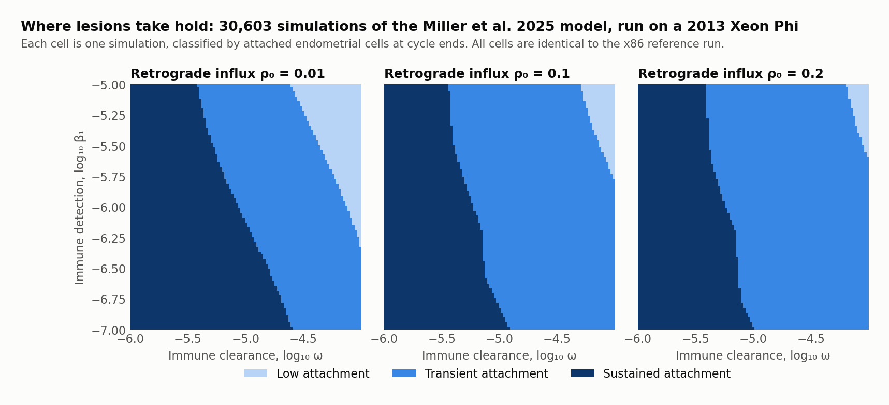
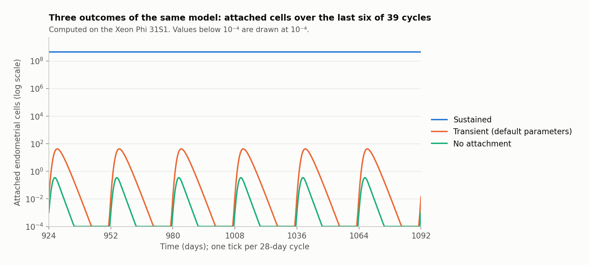
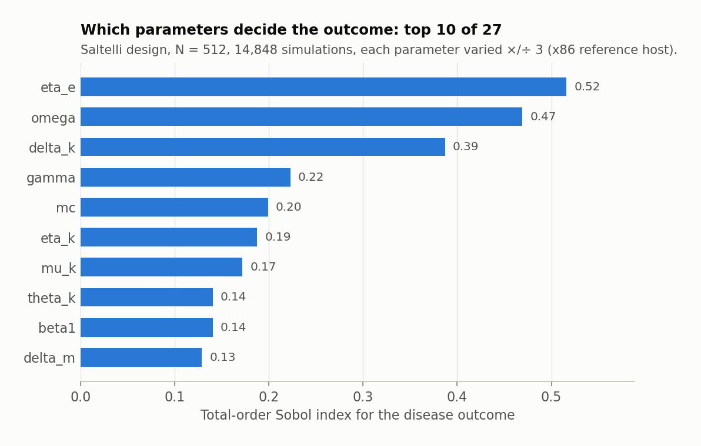
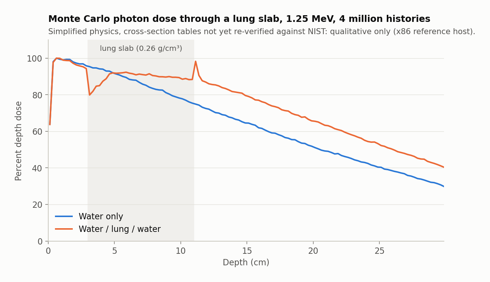

# Xeon Phi KNC codegen revival

Getting a 2013 Intel Xeon Phi x100 coprocessor (Knights Corner, card model 31S1) to boot,
compile and run validated scientific code again, and measuring what the generated code
actually does on an instruction set its vendor abandoned.

Knights Corner has 57 to 61 in-order cores and a 512-bit vector unit (IMCI, MVEX-encoded)
that is *not* AVX-512. Mainstream compilers dropped it years ago. This repository is the lab
record of bringing one card back: the boot procedure, the toolchain build, two health-rooted
simulation codes cross-compiled for it, and a small compiler-backend patch with measurements.

## What is here, and whose work it is

**Mine (this repository):**

- Bring-up of a **Xeon Phi 31S1** under a Debian 10 guest via VFIO, with the two driver
  fixes and the slot and reset rules that made it reliable (`docs/STARTUP.md`,
  `oracle/` holds the first-boot record).
- **`workloads/endomc`**: a zero-dependency Rust reimplementation of a published
  endometriosis immune-response model (Miller et al., J R Soc Interface 2025), with a
  lane-batched vector solver and a stiff Rosenbrock solver.
- **`workloads/dosemc`**: a Monte Carlo photon dose code for water and lung slab phantoms.
  Its physics is deliberately simple and its README states the limits.
- **`docs/patches/`**: a patch adding the 213 and 231 fused-multiply-add forms to the KNC
  LLVM backend, with a bit-exactness test.
- The measurements in `docs/BUILD-DAY.md` and `workloads/*/results/`.

**Not mine (used and credited):**

- The KNC LLVM/Clang and Rust toolchain is
  [ShisoftResearch's xeon-phi-toolchain](https://github.com/ShisoftResearch). The backend
  patch here is a small addition on top of it.
- Independent KNC work by Lasimeri (LLVM backend, mainline kernel on the card) is
  summarised in `docs/research/2026-11-02-prior-art.md`.
- Driver and MPSS sources are listed in `docs/SOURCES.md`.

## Results

All numbers are from the 31S1 at 228 threads unless stated; details and raw outputs are in
`docs/BUILD-DAY.md` and `workloads/endomc/results/`.

| Run (endomc, 101 x 101 x 3 parameter grid, 30,603 simulations) | Time | Agreement with the x86 reference |
|---|---|---|
| Dormand-Prince vector solver, best scheduling | 829.4 s | all 30,603 cells identical |
| Rosenbrock stiff solver, tolerance 1e-8 | 65.4 s | 30,603 of 30,603 classifications agree; different numerical method, so agreement is to tolerance, not bit for bit |
| Same, built through the patched backend | 63.5 s | bit-identical to the unpatched stiff run |
| EPYC 7742 (128 threads, AVX2), vector solver, for scale | 184.7 s | identical |

The backend patch is correctness-neutral: it removes register copies (762 to 395 in the lane
solver) and about 2.4 % of instructions, with no measurable change in run time on this
workload. It is offered as a code-quality improvement, not as a speed-up.

## Figures

All figures are drawn from the result files in this repository by
`python3 workloads/plot_figures.py` (needs numpy and matplotlib).

The model's three outcomes over time, computed on the card:

Global sensitivity of the disease outcome to all 27 parameters (run on the x86 reference host):

Photon dose through a water/lung/water slab from `dosemc` (x86 reference host). The physics
is simplified and the cross-section tables have not been re-verified against NIST, so read
this as qualitative:

## Why not use this card for real work

It draws about 180 W under load and roughly matches the two CPUs of its era. This is a
heritage and compiler-craft project, and a demonstration that old silicon can still produce
correct science. It is not an efficient compute tier.

## Documents

- `docs/STARTUP.md`: read first when the card is in a machine: the no-reset rule, the after-boot command, fans, scripts
- `docs/BUILD-DAY.md`: the toolchain build and every measured run, in order
- `docs/HARDWARE.md`: the card, the first host, and the pre-flight checklist
- `docs/SOFTWARE-ARCHAEOLOGY.md`: what of the original toolchain still exists, and where
- `docs/WORKLOADS.md`: what the card could do, with performance-per-watt numbers
- `docs/UNIVERSAL-TRANSLATOR.md`: the original question of targeting a dead instruction set from a portable language
- `docs/research/2026-11-02-prior-art.md`: other people's KNC work found in November 2026
- `docs/SOURCES.md`: every link, in one place

## License

Apache-2.0 (see `LICENSE`). The endometriosis model is the work of Miller et al.; their
reference code is CC-BY-4.0 and is cited in `workloads/endomc/README.md`.

## Original plan (August 2026), kept for the record

**Route 1 — get it lit, cheap.** Debian 10 buster on a spare drive (or VFIO the card into
a buster VM), run the ported driver + MPSS 3.8.6 unmodified. `mic0` up the same day, and
a known-good reference to diff against.

**Route 2 — then the port.** Forward-port mic/scif 4.19 → 7.0 with a working card as the
oracle. Vastly saner than debugging a blind port against silicon you have never seen boot.

Do not invert these.
